<div align="center">



<p>
  
</p>

<p>
  <a href="https://jaynaik.antideploy.app"></a>
  <a href="https://www.linkedin.com/in/jay-naik-68a00231a/"></a>
  <a href="https://github.com/Jay-Naik2526/deep-dive/blob/main/public/Jay_Naik_Resume.pdf"></a>
  <a href="mailto:naikjay208@gmail.com"></a>
</p>

</div>

---

## 🌊 Above the line

```ts
const jay = {
  location:    "Navsari, India 🇮🇳",
  education:   "B.Tech CSE @ NMIMS MPSTME Shirpur (2024–2028) · CGPA 8.48",
  now: [
    "President @ The Coding Club, NMIMS Shirpur",
    "Vice President @ Ambiora 2027 (inter-campus techfest, ~1,000 participants planned)",
    "Google Student Ambassador (monthly Gemini sessions for students)",
  ],
  before:      ["Web Developer Intern @ Infotact Solutions", "Web Dev Lead @ GDG on Campus (team of 10)"],
  focus:       ["Full-stack web", "Retrieval systems (RAG)", "3D web experiences"],
  hackathons:  ["Smart India Hackathon 2026 · Kupakosh (team lead) + NiyamKosh", "Top 10 · GDG On Campus Hackathon"],
  funFact:     "I set up an offline AI on a USB drive for exam prep 💾",
  lookingFor:  "Internships, collabs, and interesting builds.",
};
```

<div align="center">

| | |
|:-:|:--|
| 🏛️ | **President**, The Coding Club, NMIMS MPSTME Shirpur |
| 🎪 | **Vice President**, Ambiora 2027, the NMIMS inter-campus techfest |
| 🎓 | **Google Student Ambassador**, running a Gemini session every month since May 2026 |
| 💼 | **Web Developer Intern**, Infotact Solutions: led a 4-developer team on a real-time B2B SaaS workspace |
| 🎯 | **Team lead**, Smart India Hackathon 2026: Kupakosh (Oil India) and NiyamKosh (BIS) |
| 🥇 | **Top 10**, GDG On Campus Hackathon (30+ teams) |
| 🛠️ | **Technical Convenor**, Ambiora Techfest 2025: 500+ visitors, zero downtime |
| 👥 | **Former Web Dev Lead**, Google Developer Groups on Campus (10-member team) |

</div>

---

## 🤿 Dive log

<div align="center">

<table>
  <tr>
    <td width="50%"><a href="https://jaynaik.antideploy.app">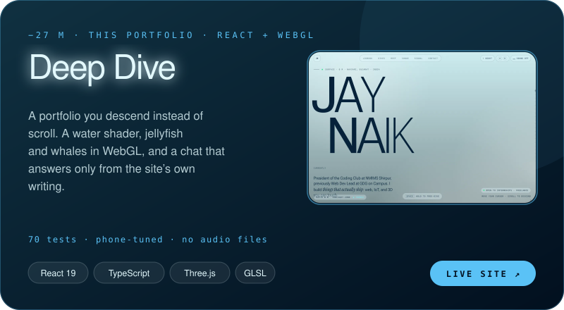</a></td>
    <td width="50%"><a href="https://coding-club-nmims.vercel.app">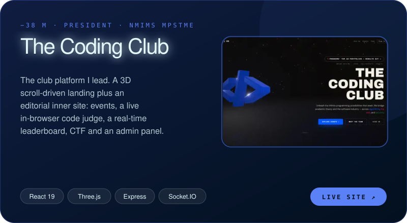</a></td>
  </tr>
  <tr>
    <td width="50%"><a href="https://github.com/Jay-Naik2526/kupakosh">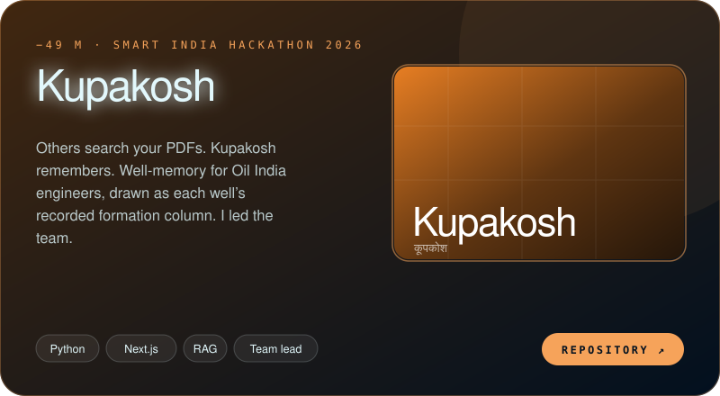</a></td>
    <td width="50%"><a href="https://github.com/Jay-Naik2526/niyamkosh">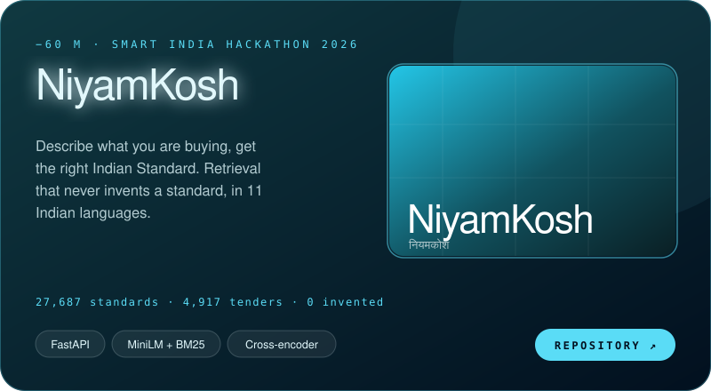</a></td>
  </tr>
  <tr>
    <td width="50%"><a href="https://github.com/Jay-Naik2526/or-studio">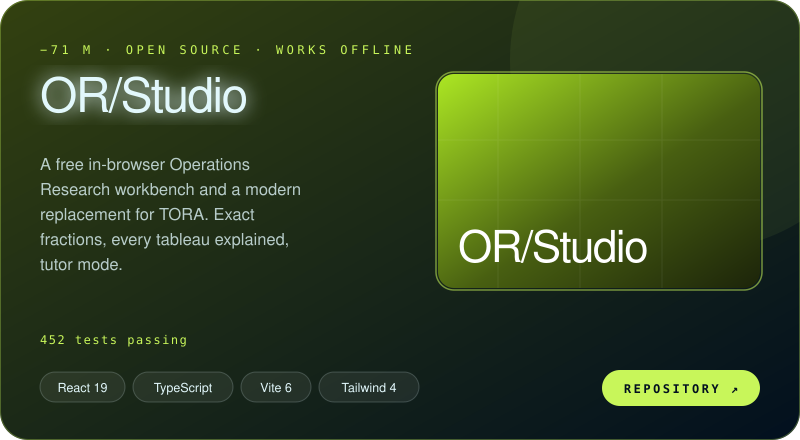</a></td>
    <td width="50%"><a href="https://studysync-inky.vercel.app">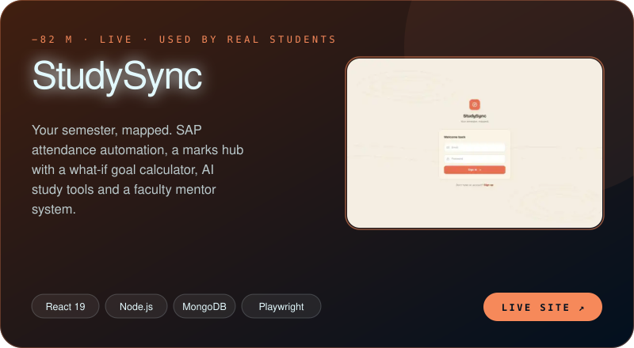</a></td>
  </tr>
  <tr>
    <td width="50%"><a href="https://ambiora-techfest.vercel.app">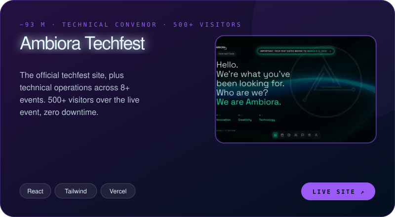</a></td>
    <td width="50%"><a href="https://flavium-official.vercel.app">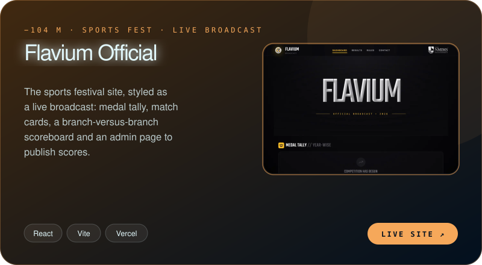</a></td>
  </tr>
  <tr>
    <td width="50%"><a href="https://github.com/Jay-Naik2526/fire-evacuation-system">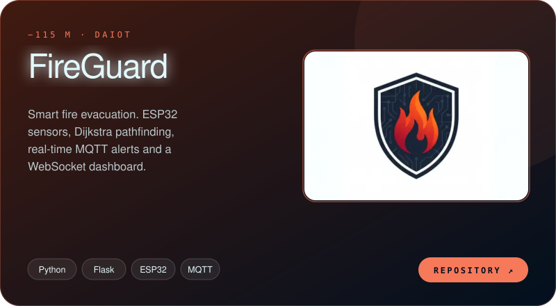</a></td>
    <td width="50%"><a href="https://w8-fitness.vercel.app">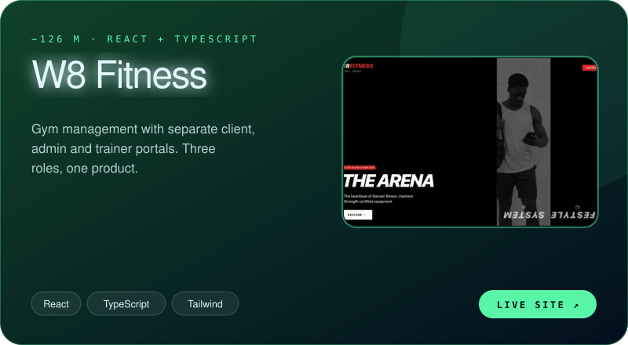</a></td>
  </tr>
</table>

</div>

### Every project, with its stack and links

| Project | What it is | Stack | Live | Code |
|:--|:--|:--|:-:|:-:|
| **Deep Dive** | This portfolio. A descent through water, with a chat that answers only from the site's own writing | React 19 · TypeScript · Three.js · GLSL · Vite | [site](https://jaynaik.antideploy.app) | [repo](https://github.com/Jay-Naik2526/deep-dive) |
| **The Coding Club** | Club platform: events, live code judge, real-time leaderboard, CTF, admin panel | React 19 · Three.js · Express · MongoDB · Socket.IO · Judge0 | [site](https://coding-club-nmims.vercel.app) | |
| **Kupakosh** | Well-memory system for Oil India (SIH 2026). I led the team | Python · Next.js · RAG | [site](https://kupakosh.duckdns.org/) | [repo](https://github.com/Jay-Naik2526/kupakosh) |
| **NiyamKosh** | Finds the right Indian Standard for a procurement need (SIH 2026). 27,687 standards, 4,917 tenders, none invented | FastAPI · MiniLM + BM25 · Cross-encoder · Bhashini | [site](https://niyamkosh.indiasouthcentral.cloudapp.azure.com/) | [repo](https://github.com/Jay-Naik2526/niyamkosh) |
| **OR/Studio** | Free in-browser Operations Research workbench, a modern TORA. 174 tests | React 19 · TypeScript · Vite · Tailwind | [site](https://or-studio.antideploy.app/) | [repo](https://github.com/Jay-Naik2526/or-studio) |
| **StudySync** | Live attendance, marks and mentor platform for real students | React 19 · Node.js · MongoDB · Playwright · Gemini | [site](https://studysync-inky.vercel.app) | [repo](https://github.com/Jay-Naik2526/studysync) |
| **Ambiora Techfest** | Official techfest site. 500+ visitors, zero downtime | React · Tailwind · Vercel | [site](https://ambiora-techfest.vercel.app) | [repo](https://github.com/Jay-Naik2526/ambiora-techfest) |
| **Flavium Official** | Sports fest site styled as a live broadcast, with an admin page for scores | React · Vite · Vercel | [site](https://flavium-official.vercel.app) | [repo](https://github.com/Jay-Naik2526/flavium-official) |
| **Skyflix** | Movies and series catalogue with a full admin panel | React · Tailwind · Node.js · MongoDB | [site](https://skyflixer.fun) | [repo](https://github.com/Jay-Naik2526/skyflix) |
| **FireGuard** | Smart fire evacuation: ESP32 sensors, Dijkstra routes, MQTT alerts | Python · Flask · ESP32 · MQTT | | [repo](https://github.com/Jay-Naik2526/fire-evacuation-system) |
| **W8 Fitness** | Gym management with client, admin and trainer portals | React · TypeScript · Tailwind | [site](https://w8-fitness.vercel.app) | [repo](https://github.com/Jay-Naik2526/W8-fitness) |

**[All 23 projects, each with a full writeup, are in the reef →](https://jaynaik.antideploy.app)**

---

## 📡 Ping the stack

<div align="center">
  
</div>

<br/>

<div align="center">

| | |
|:--|:--|
| **Languages** |       |
| **Frontend** |        |
| **Backend** |       |
| **Data** |     |
| **AI and retrieval** |    |
| **Tools** |       |
| **IoT** |    |

</div>

---

## 🪼 Plankton count

<div align="center">
  
</div>

<div align="center">
  <picture>
    <source media="(prefers-color-scheme: dark)" srcset="https://raw.githubusercontent.com/Jay-Naik2526/Jay-Naik2526/output/github-contribution-grid-snake-dark.svg" />
    <source media="(prefers-color-scheme: light)" srcset="https://raw.githubusercontent.com/Jay-Naik2526/Jay-Naik2526/output/github-contribution-grid-snake.svg" />
    
  </picture>
</div>

---

## 🎓 Credentials

- **Google AI Essentials**, Google / Coursera (2026)
- **Python for Everybody**, University of Michigan / Coursera (5-course specialization)
- **Crash Course on Python**, Google / Coursera
- **Google Student Ambassador 2026**
- Every certificate, with its verify link, is on the [portfolio](https://jaynaik.antideploy.app)

---

## 📬 Reach me

<div align="center">

[](mailto:naikjay208@gmail.com)
[](https://www.linkedin.com/in/jay-naik-68a00231a/)
[](https://jaynaik.antideploy.app)

<br/>


</div>
