<div align="center">



<p>
  
</p>

<p>
  <a href="https://jaynaik.tech"></a>
  <a href="https://www.linkedin.com/in/jay-naik-68a00231a/"></a>
  <a href="https://drive.google.com/file/d/13OciOYR9Az33goxw0QJZmFvYamSWxK_Z/view?usp=sharing"></a>
  <a href="mailto:naikjay208@gmail.com"></a>
</p>

</div>

---

## 🌊 Above the line

```ts
const jay = {
  location:    "Navsari, India 🇮🇳",
  education:   "B.Tech CSE @ NMIMS MPSTME Shirpur (2024–2028) · CGPA 8.5",
  now:         "President @ The Coding Club, NMIMS Shirpur",
  before:      "Web Dev Lead @ GDG on Campus (led a team of 10)",
  focus:       ["Full-Stack Web", "IoT Systems", "3D Web Experiences"],
  hackathons:  ["Smart India Hackathon 2026 (team lead)", "Smart India Hackathon 2025"],
  funFact:     "I set up an offline AI on a USB drive for exam prep 💾",
  lookingFor:  "Internships, collabs, and interesting builds.",
};
```

<div align="center">

| 🏛️ | **President** — The Coding Club, NMIMS MPSTME Shirpur |
|:-:|:--|
| 🎯 | **Team lead** — Smart India Hackathon 2026 (Kupakosh for Oil India, NiyamKosh for BIS) |
| 🥇 | **Top 10** — GDG On Campus Hackathon (30+ teams) |
| 🎤 | **Technical lead** — Ambiora Techfest & Flavium Sports (500+ visitors each) |
| 👥 | **Former Web Dev Lead** — Google Developer Groups on Campus (10-member team) |
| 💾 | **Built** a portable offline AI setup (llama.cpp + Qwen3-8B on a USB drive) |
| 🎓 | **Certified** — Python for Everybody, University of Michigan (5 courses) |

</div>

---

## 📡 Ping the stack

<div align="center">
  
</div>

---

## 🪼 Plankton count

<div align="center">
  
</div>

<div align="center">
  <picture>
    <source media="(prefers-color-scheme: dark)" srcset="https://raw.githubusercontent.com/Jay-Naik2526/Jay-Naik2526/output/github-contribution-grid-snake-dark.svg" />
    <source media="(prefers-color-scheme: light)" srcset="https://raw.githubusercontent.com/Jay-Naik2526/Jay-Naik2526/output/github-contribution-grid-snake.svg" />
    
  </picture>
</div>

---

## 🤿 Dive log

<div align="center">

<table>
  <tr>
    <td width="50%"><a href="https://coding-club-nmims.vercel.app">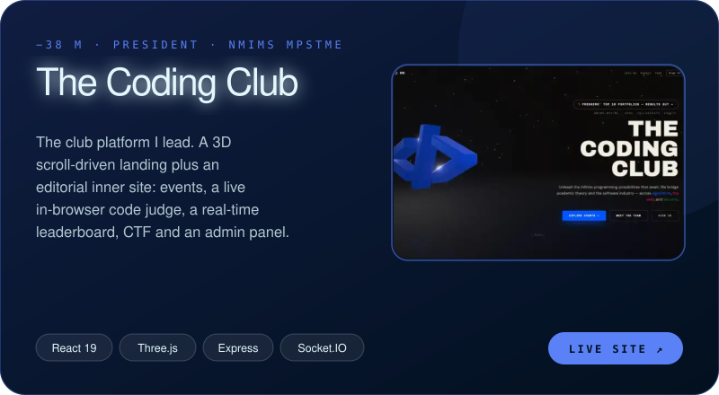</a></td>
    <td width="50%"><a href="https://github.com/Jay-Naik2526/kupakosh">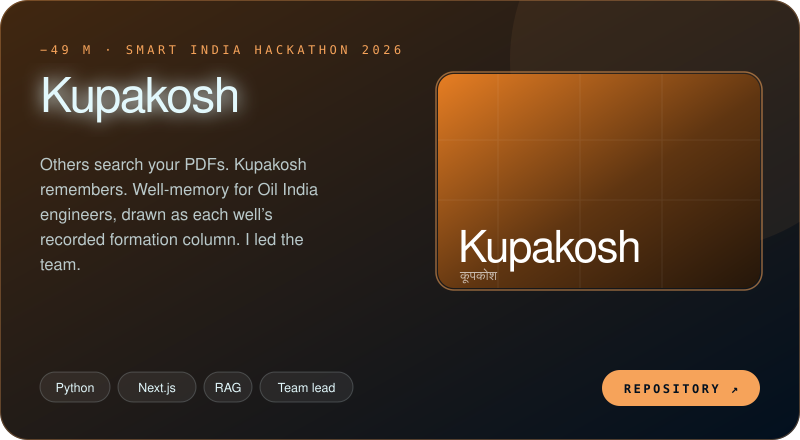</a></td>
  </tr>
  <tr>
    <td width="50%"><a href="https://github.com/Jay-Naik2526/niyamkosh">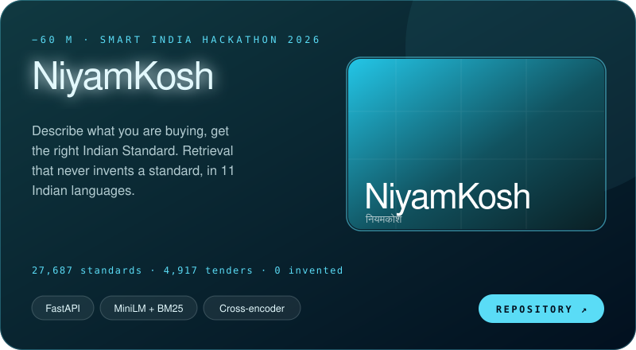</a></td>
    <td width="50%"><a href="https://github.com/Jay-Naik2526/or-studio">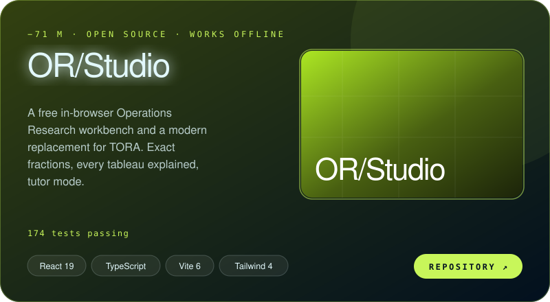</a></td>
  </tr>
  <tr>
    <td width="50%"><a href="https://studysync-inky.vercel.app">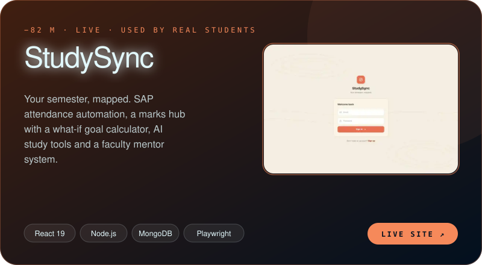</a></td>
    <td width="50%"><a href="https://ambiora-techfest.vercel.app">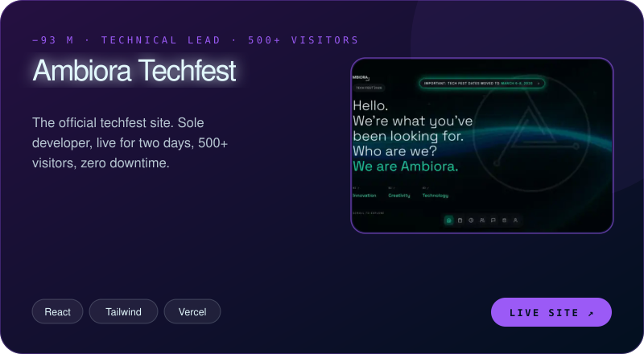</a></td>
  </tr>
  <tr>
    <td width="50%"><a href="https://github.com/Jay-Naik2526/fire-evacuation-system">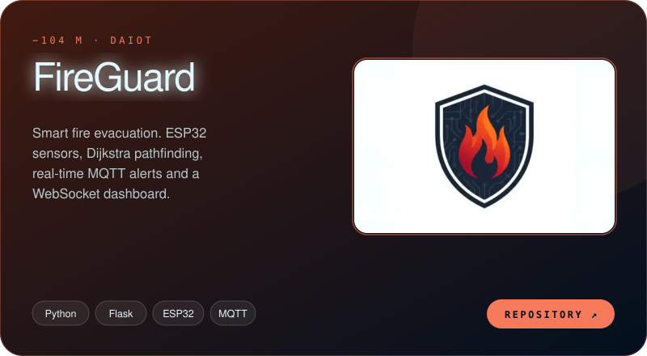</a></td>
    <td width="50%"><a href="https://w8-fitness.vercel.app">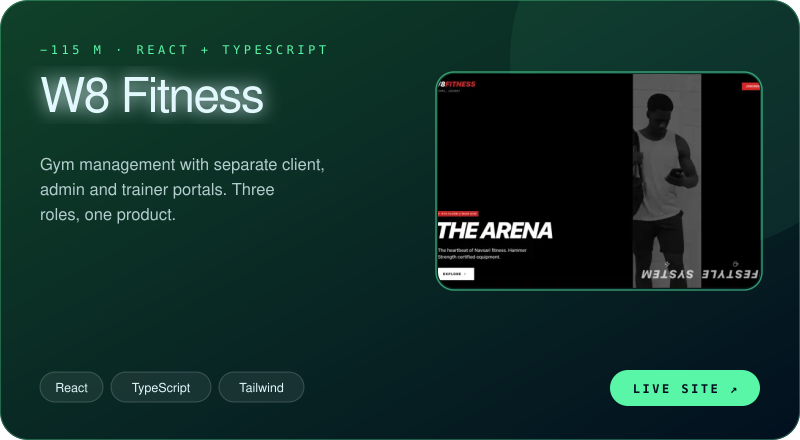</a></td>
  </tr>
</table>

<br/>

**[There's more in the reef →](https://jaynaik.tech)**

</div>

---

## 🛠️ Everything I work with

<div align="center">

                    

</div>

---

<div align="center">

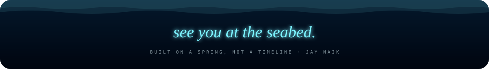

</div>
